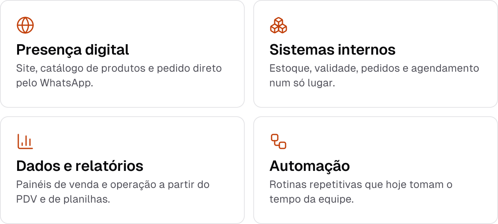

<picture>
  <source media="(prefers-color-scheme: dark)" srcset="./estuario-banner-dark.svg">
  
</picture>

  
  
  

  Estúdio de software de Belém. Sistemas web, dados e automação 
  sob medida para pequenos e médios negócios.

## O que entregamos

<picture>
  <source media="(prefers-color-scheme: dark)" srcset="./estuario-servicos-dark.svg">
  
</picture>

## Como trabalhamos

<picture>
  <source media="(prefers-color-scheme: dark)" srcset="./estuario-processo-dark.svg">
  
</picture>

## Stack

  

 

Estuário · Belém, PA

