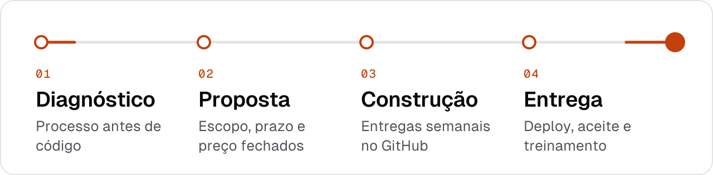

<picture>
  <source media="(prefers-color-scheme: dark)" srcset="./estuario-banner-dark.svg">
  
</picture>

  
  
  

  Estúdio de software de Belém. Sistemas web, dados e automação 
  sob medida para pequenos e médios negócios.

 

## O que entregamos

<table>
  <tr>
    <td width="50%" valign="top">
       
      <b>Presença digital</b> 
      Site, catálogo de produtos e pedido direto pelo WhatsApp.
    </td>
    <td width="50%" valign="top">
       
      <b>Sistemas internos</b> 
      Estoque, validade, pedidos e agendamento num só lugar.
    </td>
  </tr>
  <tr>
    <td width="50%" valign="top">
       
      <b>Dados e relatórios</b> 
      Painéis de venda e operação a partir do PDV e de planilhas.
    </td>
    <td width="50%" valign="top">
       
      <b>Automação</b> 
      Rotinas repetitivas que hoje tomam o tempo da equipe.
    </td>
  </tr>
</table>

## Como trabalhamos

<picture>
  <source media="(prefers-color-scheme: dark)" srcset="./estuario-processo-dark.svg">
  
</picture>

## Stack

  

 

Estuário · Belém, PA

